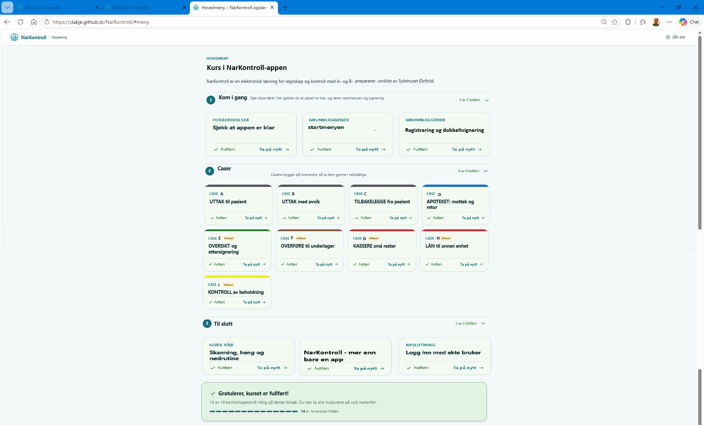
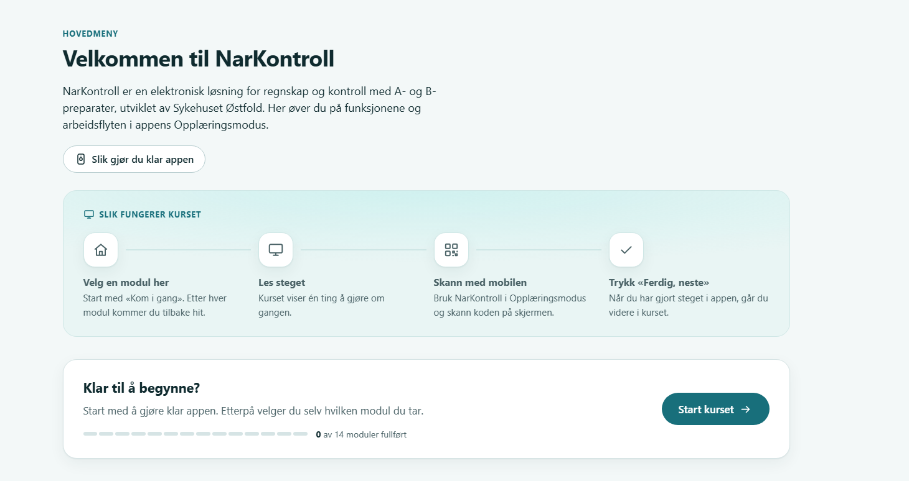
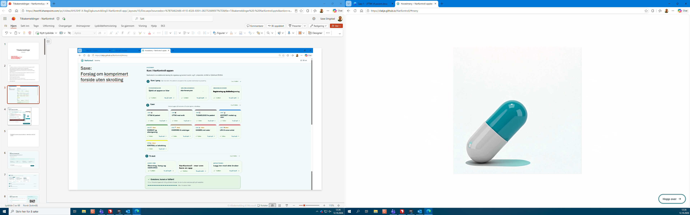
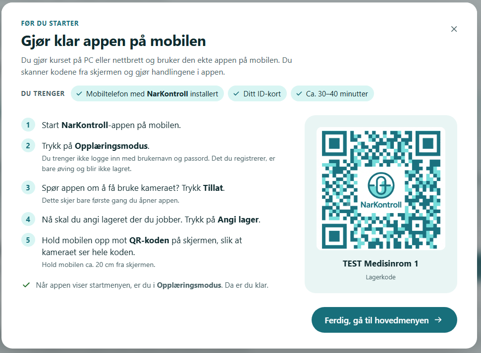
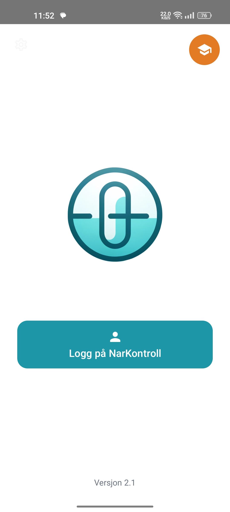

# 02 · Oppstart og hovedmeny

Introfilmen («splatt-logoen»), infoboksen «Før du starter» og hovedmenyen.
[← Til oversikten](README.md)

Saxes forslag til ny hovedmeny (lysbilde 3):

Hovedmenyen slik den er i dag, med kommentarene fra lysbilde 7:

---

## Introfilm og «Før du starter»

### H-01 · Splatt-logoen vises ikke på PC og virker ikke i Arbeidsflate

- [x] Gjort
- **Hvor:** Introfilmen, `visIntro()` i [js/app.js:1086](../js/app.js#L1086) og vilkårene på [js/app.js:1141-1142](../js/app.js#L1141-L1142)
- **Fra:** Saxe · lysbilde 2 og 4
- **Notat:** Filmen er kodet om til H.264 Main med «faststart», så den kan starte før hele filen er lastet. Står filmen stille i 3 s (henger på første bilde, slik som i Arbeidsflate), lukkes den og hovedmenyen vises. Filmen vises nå også når Windows har slått av animasjoner. Må testes i Arbeidsflate.

> Kul splatt-logo med kapsel som blir til logoen på mobil/pad. Kan animasjonen også komme på PC?

> Splatt logo virker ikke inne i Arbeidsflate

**Tolkning:** Saxe har sett filmen på mobil og nettbrett, men ikke på PC. Filmen skal vises der også.
Mulige årsaker å sjekke:
- Filmen hoppes over når Windows har «Vis animasjoner» slått av (`prefers-reduced-motion: reduce`). Det er vanlig i virtuelle skrivebord som Arbeidsflate.
- Filmen lukkes hvis den ikke har startet etter 3 sekunder, eller hvis nettleseren blokkerer autoavspilling.
- Nettleseren i Arbeidsflate støtter kanskje ikke formatet i `introfilm.mp4`.

---

### H-02 · «Før du starter» er rotete. Gå rett fra logoen til hovedmenyen

- [x] Gjort
- **Hvor:** Infoboksen «Før du starter», `oppstart` i [kurs.js:32](../content/kurs.js#L32)
- **Fra:** Saxe · lysbilde 5
- **Notat:** Infoboksen er fjernet. Introfilm → hovedmeny. Stegene står nå som første steg i M0 (stegtypen `registrer`), med lagerkoden `LAGER-01`. «Du trenger» og PC/mobil står i M0-ingressen. Plassholderbildet `qr-plassholder.png` er slettet.

> Denne siden er litt rotetete
> Kan det gjøre som en del av modul 1?
> Altså første man møte er "splatt"logoen
> Deretter automatisk videre til kursets hovedmeny

**Tolkning:** Fjern infoboksen som første skjerm. Ny rekkefølge: introfilm → hovedmeny. Innholdet i «Før du starter» (start appen, Opplæringsmodus, tillat kamera, skann lagerkoden) flyttes inn i den første modulen, «Sjekk at appen er klar» (M0).

---

### H-03 · Ny tekst om Opplæringsmodus

- [x] Gjort
- **Hvor:** «Før du starter» steg 2, [kurs.js:44](../content/kurs.js#L44). Følger med innholdet hvis det flyttes til M0 ([H-02](#h-02))
- **Fra:** Saxe · lysbilde 5 (tekst lagt oppå skjermbildene)
- **Notat:** Raden lyder «Trykk på ikonet øverst til høyre for å gå til **Opplæringsmodus**.», med Saxes tekst under (skrivefeilene er rettet).

Ved skjermbildet av appen, med pil mot det oransje ikonet:

> ikonet øverst til høyre

Ved steg 2 «Trykk på Opplæringsmodus»:

> I opplæringsmodus er det ingeninnlogging med ekte brukernavn og passord.
> Registreringer som gjøres i opplæringmodus slettes når modusen avsluttes.

**Tolkning:**
- Steg 2 bør si hvor knappen er, for eksempel: «Trykk på ikonet øverst til høyre for å gå til **Opplæringsmodus**.»
- Hjelpeteksten erstattes med Saxes tekst. I dag står det: «Du trenger ikke logge inn med brukernavn og passord. Det du registrerer, er bare øving og blir ikke lagret.»

---

## Hovedmenyen

### H-04 · Hovedmenyen må få plass på én skjerm uten skrolling

- [x] Gjort
- **Hvor:** `visMeny()` i [js/app.js](../js/app.js) og menystilene i [css/app.css](../css/app.css)
- **Fra:** Saxe · lysbilde 2 og 3. Ikke navngitt · lysbilde 7
- **Notat:** Får plass uten skrolling i 1280 × 650 (16"), 1366 × 600 og 1920 × 950 (24"). Gruppene er alltid åpne. Fra 1000 px bredde står gruppenavnet til venstre for kortene, ellers ble det for høyt. Kortene er fem i bredden.

> Hovedmeny i kurset må være på èn side uten skrolling! Nå mister man oversikten grunnet skrolling. - optimaliser for 24"/16"

> Forslag om komprimert forside uten skrolling (Saxe, lysbilde 3)

> Mye info uoversiktlig (lysbilde 7)

**Tolkning:** Mål: hele hovedmenyen synlig uten skrolling på 16" bærbar og 24" skjerm. Saxes forslag (bildet øverst) viser:
- kort tittel og én linje ingress
- de tre gruppene «Kom i gang», «Caser» og «Til slutt» åpne under hverandre
- små kort i rutenett, fire i bredden, med bare merkelapp, tittel og «Fullført / Ta på nytt»
- en smal fremdriftslinje nederst

Punktene [H-05](#h-05) til [H-09](#h-09) er de enkelte grepene.

---

### H-05 · Slett «Slik fungerer kurset»

- [x] Gjort
- **Hvor:** Boksen «Slik fungerer kurset» i hovedmenyen, [js/app.js:651](../js/app.js#L651)
- **Fra:** Saxe · lysbilde 2. Ikke navngitt · lysbilde 7
- **Notat:** Slettet, sammen med `slikHtml()` og CSS-en.

> Slette: "Slik fungerer kurset" (overforklarende og tar opp plass) Ev. mulighet til å minimere boksen...?

> Slette: Slik fungerer kurset

**Tolkning:** Begge vil ha den bort. Saxe nevner å kunne minimere den som et alternativ. Slett den.

---

### H-06 · Lavere modulkort uten grå tekst

- [x] Gjort
- **Hvor:** Modulkortene i hovedmenyen ([js/app.js](../js/app.js), rundt linje 727). Den grå teksten er `kortTekst` på hver modul i [kurs.js](../content/kurs.js)
- **Fra:** Saxe · lysbilde 2
- **Notat:** Beskrivelsen er fjernet fra kortene, men står fortsatt øverst i modulen. Status vises som et lite merke oppe til høyre (hake for fullført, «2/4» for påbegynt). «Anbefalt neste»-merket er fjernet. Anbefalt kort har ramme, og knappen står i fremdriftslinjen.

> Gjøre alle kvadratboksene lavere, og slette den grå skriften.

**Tolkning:** Fjern beskrivelsen (`kortTekst`) fra kortene i hovedmenyen. Den kan fortsatt brukes øverst inne i modulen.

---

### H-07 · «-app» i tittelen

- [x] Gjort
- **Hvor:** Hovedmenyens tittel «Velkommen til NarKontroll», [kurs.js:23](../content/kurs.js#L23)
- **Fra:** ikke navngitt · lysbilde 7
- **Notat:** Tittelen er nå «Kurs i NarKontroll-appen», som i Saxes forslag. Spørsmålet under står fortsatt åpent.

> -app

**Tolkning:** Står ved tittelen på skjermbildet. Trolig skal det stå «NarKontroll-appen», slik som i Saxes forslag: «Kurs i NarKontroll-appen».
**❓ Avklares:** Bekreft ønsket tittel.

---

### H-08 · Ingressen på én linje

- [x] Gjort
- **Hvor:** `hovedmeny.ingress`, [kurs.js:24](../content/kurs.js#L24)
- **Fra:** ikke navngitt · lysbilde 7
- **Notat:** Ingressen er Saxes tekst. Knappen «Slik gjør du klar appen» er fjernet.

> Teksten til venstre kan være på bare en linje

**Tolkning:** Kort ned ingressen, for eksempel: «NarKontroll er en elektronisk løsning for regnskap og kontroll med A- og B-preparater, utviklet av Sykehuset Østfold.» (Saxes forslag har denne teksten.) Fjern også knappen «Slik gjør du klar appen» hvis «Før du starter» forsvinner ([H-02](#h-02)).

---

### H-09 · Smal fremdriftsindikator nederst

- [x] Gjort
- **Hvor:** Boksen «Klar til å begynne?» med fremdriftslinjen, [js/app.js:686-710](../js/app.js#L686-L710)
- **Fra:** Saxe · lysbilde 2. Ikke navngitt · lysbilde 7
- **Notat:** Én smal linje nederst: status, antall fullført, hvor fremdriften lagres, fremdriftssporet og knappen videre.

> Legge fremdriftsboks smalt øverst oppe eller nederst nede

> Fremdriftindikatoren gjøres smalere og legges nederst i bunn.

**Tolkning:** Begge foreslår nederst. Gjør den til én smal linje (som i Saxes forslag).

---

### H-10 · «Kom i gang» som det første man ser

- [x] Gjort
- **Hvor:** Gruppen «Kom i gang» i hovedmenyen, `grupper` i [kurs.js:56](../content/kurs.js#L56)
- **Fra:** ikke navngitt · lysbilde 8
- **Notat:** Den store tittelen og «Slik fungerer kurset» er borte, og «Klar til å begynne?» er nå den smale linjen nederst ([H-09](#h-09)). Over gruppene står bare én linje med tittel og ingress.

> Kom i gang og disse første firkantene kan dette vær det første man ser og være hovedmenyen

**Tolkning:** Fjern innholdet over gruppene (stor tittel, ingress, «Slik fungerer kurset», «Klar til å begynne?»), så modulkortene kommer øverst. Merk at «Kom i gang» blir kortere når M1 slettes og M2 flyttes inn i casene ([K-02](03-kom-i-gang-M0-M2.md#k-02), [K-03](03-kom-i-gang-M0-M2.md#k-03)).
